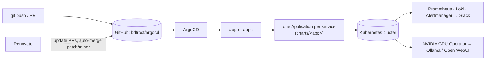

# argocd: GitOps for my home Kubernetes cluster

Every workload, operator and piece of cluster plumbing on my home Kubernetes cluster is declared in this repo, and ArgoCD keeps the cluster matching it. Nothing is applied by hand. **A merge to `main` is a deploy.**

I use it as a small-scale version of the platform patterns I run at work: an app-of-apps layout, automated dependency updates, encrypted secrets in a public repo, observability for everything, and GPU workloads.

| | |
|---|---|
| ArgoCD Applications | ~49, all auto-synced with `prune` and `selfHeal` |
| Commits | 2,600+ since Dec 2024: about 2,000 by hand, 580+ automated Renovate updates |
| Secrets in plaintext | 0 (Sealed Secrets) |
| Manual `kubectl apply` | none |

Built and maintained by [Brian D. Frost](https://briandfrost.com).

## Architecture



```
apps/                          Helm chart that renders one ArgoCD Application per workload
  templates/app-of-apps.yaml   root Application → points ArgoCD at apps/
  templates/<app>.yaml         child Application → points at charts/<app>
charts/<app>/                  per-app config: wrapper charts, local charts or kustomize
scripts/                       helpers for sealing secrets
renovate.json                  automated dependency updates
```

- **App of apps.** A root `Application` renders a child `Application` for each service. Every app syncs automatically with `prune` and `selfHeal`, so ArgoCD reverts any drift, and deleting a file removes its workload.
- **Each app uses whichever packaging style fits it:**
  - *Wrapper charts* pin an upstream Helm chart and add local templates for things like ingress and secrets. Used for kube-prometheus-stack, Immich and kagent.
  - *Hand-written charts* are for apps that ship no chart. For example, Tracearr's chart runs its own TimescaleDB and Redis StatefulSets.
  - *Plain kustomize* is for small sets of manifests, such as cert-manager and the Prometheus exporters.
- **New services start from a template.** `apps/templates/_boilerplate` and `charts/boilerplate` set one up.

## Platform

| Concern | Implementation |
|---|---|
| GitOps | ArgoCD, app-of-apps, automated sync with prune and self-heal |
| CNI | Flannel |
| Ingress | ingress-nginx, plus Cloudflare Tunnel (`cloudflared`) for selected external access |
| TLS | cert-manager with Let's Encrypt DNS-01 via Cloudflare |
| DNS | external-dns → Technitium over RFC2136 (TSIG) |
| Storage | Synology CSI (iSCSI) for dynamic PersistentVolumes |
| Secrets | Sealed Secrets |
| Observability | kube-prometheus-stack (Alertmanager → Slack), Loki, Dozzle, Uptime Kuma with AutoKuma, custom Prometheus exporters |
| Cluster hygiene | descheduler, Stakater Reloader, metrics-server |
| GPU | NVIDIA GPU Operator |
| Dashboard | Homepage, using in-cluster service discovery |

## AI on Kubernetes

- **Ollama and Open WebUI** serve LLMs on a local NVIDIA GPU. The GPU Operator handles the drivers and the device plugin.
- **kagent** runs Kubernetes-native AI agents, backed by Postgres on Synology storage.

## Secrets in a public repo

This repo is public, so it contains no plaintext secrets. All credentials are [Sealed Secrets](https://github.com/bitnami-labs/sealed-secrets): they're encrypted with the cluster's public key, and only the controller running in the cluster can decrypt them. Sealing is handled by `scripts/generate-secret.sh` and `scripts/seal-release-notify-webhook.sh`. Config files that need tokens use placeholders, which are filled in from sealed secrets at runtime.

## Automated updates

Renovate scans every chart and manifest in the repo:

- **Patch, minor and digest updates merge automatically** through GitHub's native automerge, and ArgoCD rolls them out with no human involved.
- **Major updates wait for manual review.**
- **A custom regex versioning rule handles Plex's image tags.** Plex tags look like `<version>-<git-hash>`, and Renovate's default Docker versioning treats the hash as an incompatible suffix and silently skips every update. The rule is documented in `renovate.json`.

## Engineering notes

A few problems this repo solves that are worth knowing about:

- **Safe pruning.** Every Application syncs with `PrunePropagationPolicy=foreground` and `PruneLast=true`, so ArgoCD removes resources only after everything else has synced.
- **Annotation drift on StatefulSets.** Some pod-template annotations, such as on Plex's StatefulSet, are changed at runtime. `ignoreDifferences` covers exactly that field, so self-heal doesn't fight the change and real drift is still caught.
- **Monitoring that configures itself.** AutoKuma creates Uptime Kuma checks from in-cluster config, so a new service gets uptime monitoring without anyone clicking through the Uptime Kuma UI.
- **Exporters for apps that don't expose metrics.** Small kustomize-deployed exporters feed Prometheus, so those apps get the same dashboards and alerts as everything else.

## What runs on it

General self-hosted services: an Immich photo library, a Plex media server and the automation that supports it, Homepage, changedetection.io, speedtest-tracker and BirdNET-Go bird identification. The full list is in [`apps/templates/`](apps/templates/).
